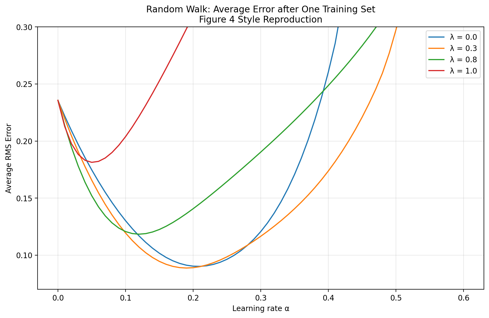
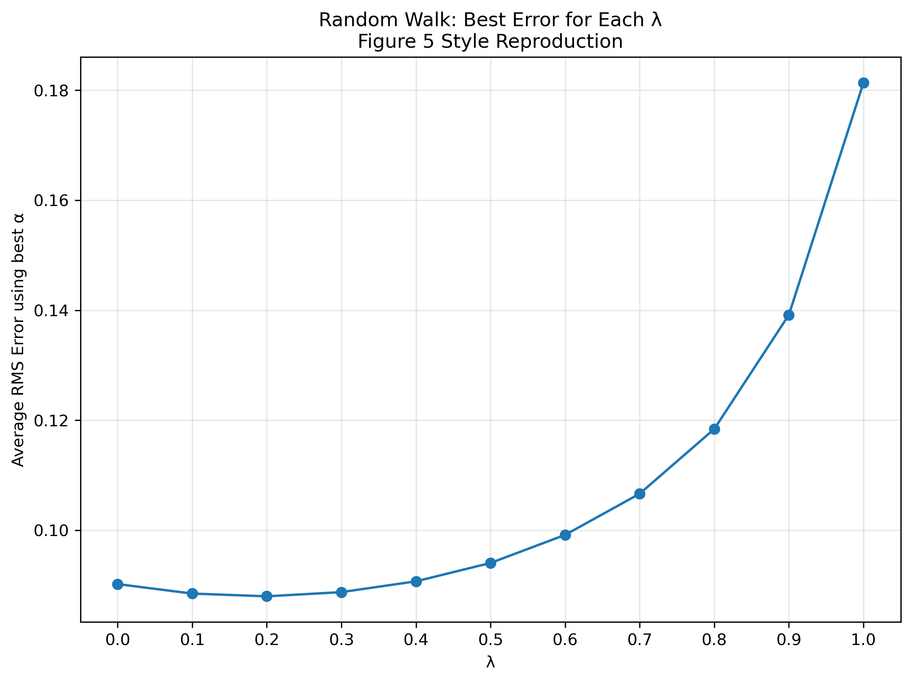

# Sutton 1988 TD(λ)：随机游走实验二复现

复现 Richard S. Sutton 的 *Learning to Predict by the Methods of Temporal Differences*（1988）第 3 节实验二，对应原文 Figure 4、Figure 5。

论文：[DOI: 10.1007/BF00115009](https://doi.org/10.1007/BF00115009)。

本项目旨在复现原文实验二的方法和主要定性结论。判断依据是训练与评估流程是否符合原文、结果趋势是否支持原文结论，并明确记录本次参数与差异；不要求随机样本下的误差数值、最优参数或曲线逐点相同。

## 安装与运行

使用 Python 3.11（本项目已验证的版本），在项目目录执行：

```bash
python -m pip install -r requirements.txt
python random_walk_td_lambda.py --no-show
```

`requirements.txt` 指定 NumPy 1.26.4 和 Matplotlib 3.9.2；Python 版本需自行准备，无需 GPU。可以使用已有 Python 环境，也可以按需用 `python -m venv .venv` 创建独立环境，激活后执行上述命令。

在 VS Code 中，选择已安装这些依赖的 Python 解释器，然后运行脚本即可。

去掉 `--no-show` 可显示图窗；默认图片保存在脚本旁的 `results/`。可用 `--output-dir PATH` 更改输出位置。

每次运行生成三张 PNG 图片和三份数据文件：`all_results.csv` 保存全部 671 组参数的平均 RMS；`best_results.csv` 保存各 λ 的最佳 α 及最低误差；`training_sets.json` 保存这次计算实际使用的 100 个训练集（每集 10 条游走）。

## 实验设置

- A–B–C–D–E–F–G 随机游走，从 D 开始，左右移动概率均为 0.5；A/G 为终点，结果分别为 0/1。
- 100 个训练集，每集 10 条游走；随机种子为 42，所有参数组合使用相同数据。
- 每个训练集重新初始化五个权重为 0.5；每条游走结束后更新权重，训练集只呈现一遍。
- 先对五个非终止状态求 RMS，再对 100 个训练集取平均。
- α 从 0 到 0.60，间隔 0.01；这一测试范围和间隔由本次复现选定。
- Figure 4 展示 λ=0、0.3、0.8、1 四条代表曲线。
- Figure 5 按原图可见点位，采用 λ=0、0.1、…、1；正文没有逐项列出该实验测试的全部 λ 取值。
- 总共计算 11×61=671 个参数组合。

程序测试了全部 11 个 λ，但 Figure 4 只展示其中 4 个的误差曲线，方便与原文代表曲线对照。增加其他 λ 的测试本身不构成算法错误；这组绘图选择也不是复现成功的必要条件。

## 图片

| 本项目图片 | 对应原论文 | 含义 |
|---|---|---|
| `figure4_alpha_error.png` | Figure 4，印刷第 21 页（PDF 第 13 页） | 固定 λ 时，平均 RMS 随 α 的变化 |
| `figure4_alpha_error_zoom.png` | 同一 Figure 4 的局部放大 | 与上一张使用相同数据，方便观察低误差区域 |
| `figure5_lambda_best_error.png` | Figure 5，印刷第 22 页（PDF 第 14 页） | 每个 λ 取最佳 α 后的最低平均 RMS |

原论文 Figure 3 属于反复呈现训练集的实验一，本项目未复现该实验。

`figure4_alpha_error.png` 为 Figure 4 的全范围结果。下图是同一结果的低误差区域放大图，纵轴仅显示 0.07–0.30：



Figure 5 为每个 λ 从本次测试的 α 取值中选出误差最低的一个，再比较各 λ 的最低平均 RMS：



## 本次结果（seed=42）

下表根据运行后保存的 `results/best_results.csv` 核对；`results/all_results.csv` 包含全部 671 组参数组合，`results/training_sets.json` 包含实际使用的 100 个训练集，每集 10 条游走。

| λ | 最佳 α | 平均 RMS |
|---:|---:|---:|
| 0.0 | 0.21 | 0.09019 |
| 0.1 | 0.20 | 0.08847 |
| 0.2 | 0.20 | 0.08797 |
| 0.3 | 0.19 | 0.08873 |
| 0.4 | 0.18 | 0.09069 |
| 0.5 | 0.17 | 0.09403 |
| 0.6 | 0.15 | 0.09914 |
| 0.7 | 0.14 | 0.10663 |
| 0.8 | 0.12 | 0.11840 |
| 0.9 | 0.09 | 0.13915 |
| 1.0 | 0.05 | 0.18137 |

主要趋势与论文相似：适中的 α 较好，小的非零 λ 表现较优，TD(1) 的最佳误差较高。在本次测试的 671 组参数组合中，λ=0.2、α=0.20 的平均 RMS 最低，为 0.08797；原文报告的最佳 λ 在 0.3 附近。

这是使用固定随机种子 42、100 个训练集，并测试上述 α 和 λ 取值后得到的结果。程序没有测试所有可能的参数取值，也没有对接近的 λ 做显著性检验，因此不能据此认定总体最优 λ 必然是 0.2。原始训练序列不可用，α 的测试范围和间隔也由本次复现选定；随机样本和参数选择可能影响数值，但尚未通过多种子实验分离这些影响。

## 独立复现参考

Conge 在 2015 年的 [Solving Five-step Random-Walk problem with TD(λ)](https://conge.livingwithfcs.org/2015/11/29/Solving-Five-step-Random-Walk-problem-with-TD%28%CE%BB%29-Fall-2015-CS8803-RL/) 中，也报告实验二表现较好的学习率约为 0.2、最佳 λ 约为 0.2，并认为主要发现支持 Sutton 原文，尽管具体数值不同。


